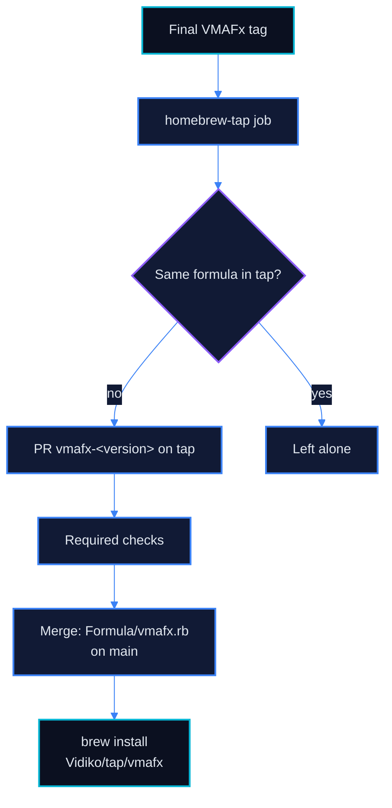

<!--
SPDX-FileCopyrightText: 2026 Lusoris <lusoris@pm.me>
SPDX-License-Identifier: EUPL-1.2
-->
<!-- markdownlint-disable MD013 MD033 MD041 -->

<div align="center">

  

  <!-- README-STANDARD badge block: one group, fixed order -->
  <!-- 2 CI/build -->
  [](https://github.com/vidiko/homebrew-tap/actions/workflows/ci.yml)
  [](https://github.com/vidiko/homebrew-tap/actions/workflows/reuse.yml)
  [](https://github.com/vidiko/homebrew-tap/actions/workflows/pages.yml)
  <!-- 3 security/scorecard -->
  [](SECURITY.md)
  <!-- 4 standards -->
  [](AGENTS.md)
  [](CONTRIBUTING.md)
  <!-- 5 licence -->
  [](LICENSE)
  <!-- 6 support -->
  [](https://github.com/sponsors/lusoris)
  [](https://ko-fi.com/lusoris)

  **Homebrew formulae for VMAFx and the tools Vidiko builds on it.**

  *No formula yet; the first arrives with the first final VMAFx release.*

</div>

homebrew-tap is the Homebrew tap of the Vidiko organisation for VMAFx, the
perceptual video quality library and toolkit, and the tools Vidiko builds on
it. Once the first formula pull request merges, install it with
`brew install Vidiko/tap/vmafx`. The VMAFx release job writes the formula;
it is not edited by hand
([ADR-3387](https://github.com/VMAFx/vmafx/blob/master/docs/adr/3387-homebrew-tap-publish.md)).

A Homebrew *tap* is a Git repository of formulae that `brew tap` adds next to
the core formulae. Homebrew requires the repository name `homebrew-<name>`;
`brew` addresses this one as `Vidiko/tap`. Vidiko is the organisation that
succeeds VMAFx, where new project repositories are created. *Tap* is
Homebrew's own term from its beer-brewing vocabulary. Pronunciation is
**HOME-brew tap** (/ˈhoʊm.bruː tæp/)
([Homebrew Taps](https://docs.brew.sh/Taps), [docs/index.md](docs/index.md)).

**[📖 Documentation](https://vidiko.github.io/homebrew-tap/)** · [Documentation source](docs/)

---

## 🎯 Why this tap

| Aspect | How the tap handles it |
| :--- | :--- |
| Generated formula | VMAFx generates the formula from its distribution manifest; it is not edited by hand ([ADR-3317](https://github.com/VMAFx/vmafx/blob/master/docs/adr/3317-distribution-manifest.md), [ADR-3387](https://github.com/VMAFx/vmafx/blob/master/docs/adr/3387-homebrew-tap-publish.md)). |
| Pull requests and checks | The publisher opens a pull request, and the tap requires Verification gate, Docs build and REUSE lint checks ([ADR-3387](https://github.com/VMAFx/vmafx/blob/master/docs/adr/3387-homebrew-tap-publish.md), [ruleset](.github/rulesets/main.json)). |
| Final releases | The publisher runs for final versions; release candidates are not published to the tap ([ADR-3387](https://github.com/VMAFx/vmafx/blob/master/docs/adr/3387-homebrew-tap-publish.md)). |
| Licence and REUSE | The tap is licensed under EUPL-1.2 and records file licence information using REUSE ([LICENSE](LICENSE), [REUSE.toml](REUSE.toml)). |

## 🚀 Get started

```sh
brew tap Vidiko/tap
brew install Vidiko/tap/vmafx
```

There is no formula yet ([Formula/](Formula/)); installation fails until the
first final VMAFx release's formula pull request merges
([ADR-3387](https://github.com/VMAFx/vmafx/blob/master/docs/adr/3387-homebrew-tap-publish.md)).

## 🧩 At a glance

The VMAFx release job proposes a generated formula for the tap's checks and
merge ([ADR-3387](https://github.com/VMAFx/vmafx/blob/master/docs/adr/3387-homebrew-tap-publish.md)).



## 📚 Guides and reference

| Page | What it answers |
| :--- | :--- |
| [Documentation site](https://vidiko.github.io/homebrew-tap/) | Where to find the published overview and decisions ([mkdocs.yml](mkdocs.yml)). |
| [Decision records](docs/adr/README.md) | Where the tap's architectural decisions are indexed. |
| [CONTRIBUTING.md](CONTRIBUTING.md) | How to contribute and verify changes. |
| [SECURITY.md](SECURITY.md) | How to report a vulnerability. |
| [VMAFx ADR-3387](https://github.com/VMAFx/vmafx/blob/master/docs/adr/3387-homebrew-tap-publish.md) | How a release publishes a formula pull request. |
| [VMAFx ADR-3317](https://github.com/VMAFx/vmafx/blob/master/docs/adr/3317-distribution-manifest.md) | How the distribution manifest generates the formula. |
| [Homebrew Taps](https://docs.brew.sh/Taps) | How taps are named and added. |

## 🤝 Contribute

Formulae are generated; fixes belong in the VMAFx manifest or generator
([ADR-3317](https://github.com/VMAFx/vmafx/blob/master/docs/adr/3317-distribution-manifest.md)).
Read [CONTRIBUTING.md](CONTRIBUTING.md) and the agent rules in
[AGENTS.md](AGENTS.md). Run the same gate as CI before contributing:

```sh
make verify-all
```

Every commit needs a `Signed-off-by` trailer; the Verification gate checks
each non-merge commit of a pull request
([CI workflow](.github/workflows/ci.yml)).

## 💖 Support

- **Security vulnerabilities**: report privately under [SECURITY.md](SECURITY.md).
- **Questions and bugs**: open an issue on [GitHub Issues](https://github.com/vidiko/homebrew-tap/issues).
- **Sponsorship**: support the project through [GitHub Sponsors](https://github.com/sponsors/lusoris) or [Ko-fi](https://ko-fi.com/lusoris).

## 📈 Roadmap and releases

- The first formula is planned for the first final VMAFx release; it becomes
  installable after its pull request merges.
- Release candidates are not published to the tap.
- The tap has no releases of its own; the formula version is the VMAFx version.

The publication process is described in [ADR-3387](https://github.com/VMAFx/vmafx/blob/master/docs/adr/3387-homebrew-tap-publish.md).

## Upstream and licence

[Homebrew](https://brew.sh) supplies the tap mechanism; no Homebrew code is
vendored here ([Formula/](Formula/)). The documentation site configuration is
adapted from the Praetor MkDocs preset ([mkdocs.yml](mkdocs.yml)).

homebrew-tap is licensed under the European Union Public Licence 1.2
([LICENSE](LICENSE)), the licence of VMAFx's own code. Licence and copyright
information for every file follows the [REUSE](https://reuse.software)
specification ([REUSE.toml](REUSE.toml), [LICENSES/](LICENSES/)).

## Standards & Governance

This repository declares the High-Integrity Systems Standard (HISS-21) in
[AGENTS.md](AGENTS.md). The `make verify-all` target defined in
[Makefile](Makefile) is the repository gate.

<!-- praetor:readme-governance:start -->
Praetor manages this repository's declared governance policy. This managed
block records adoption state; it is not a verification certificate.

**Verification**: `make verify-all` runs the repository's configured
verification cascade.

**HISS Audit**: `praetorctl audit` enforces policy, generated-surface
integrity, and the debt ratchet.

**Context Sync**: `praetorctl compile-context --verify` verifies every
generated agent context against `AGENTS.md`.

**Debt Baseline**: `.standards-baseline.json` anchors the debt ratchet at
0 recorded infractions; audit forbids growth.
<!-- praetor:readme-governance:end -->
